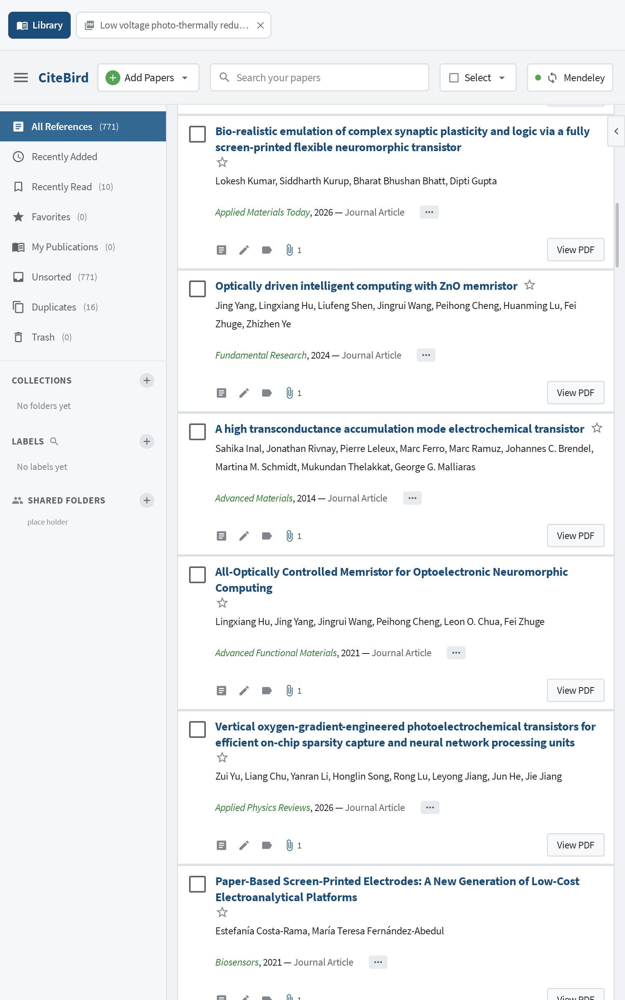

# CiteBird — Open-Source Mendeley for Android Replacement

An open-source, tablet-first **reference manager and academic PDF reader** built as a modern replacement for the discontinued **Mendeley for Android** app.

Designed for Android 16+ tablets (Paperpile-inspired 3-column workspace + Mendeley Web Library sync, folders/collections, labels, and distraction-free PDF reading & annotation).

## Why CiteBird?

Elsevier discontinued the official **Mendeley for Android** app (1.20.1, `targetSdk 29`). CiteBird provides an open-source, pure-Kotlin / Jetpack Compose alternative that connects directly to your Mendeley library while keeping all PDFs and annotations local on your tablet.

## Screenshots

| Landscape | Portrait |
| --- | --- |
|  |  |

## Features

- **Mendeley Library Sync (Non-Blocking Background Pull):**
  - Sign in via Mendeley's official web session (`www.mendeley.com`).
  - Pulls references, PDFs, folders/collections, tags (colored labels), and starred status in the background while you continue browsing and reading already-downloaded papers.
- **3-Column Tablet Workspace:**
  - **Collapsible Left Sidebar:** `All References`, `Recently Added`, `Recently Read`, `Favorites`, `My Publications`, `Unsorted`, `Duplicates`, `Trash`, `Collections` (Mendeley folders), and `Labels`.
  - **Paper Cards & Inline Attachment Drawer:** Star, multi-select, edit metadata, BibTeX/DOI copy, notes/abstract editor, save PDF to disk via SAF, and open journal DOI links.
  - **Collapsible Right Filter & Sort Panel:** Live counts, sort (`Date Added`, `Publication Date`, `Title`, `Journal`, `Author`), and facet filters (`Has PDF`, `Has no PDF`, `Unsorted`, `Incomplete`, `Notes`, `Type`).
- **PDF Reader & Annotations:**
  - **Continuous Scroll** and **Single Page** modes.
  - **1 Page** and **2 Pages (Book Spread)** layouts.
  - Pinch-to-zoom, page jump, reading progress persistence, highlights, and sticky notes stored in Room.
  - Full-screen immersive mode with auto-hiding system bars (swipe down from edge to reveal).
- **Zero Proprietary PDF SDKs & Zero Telemetry:**
  - Uses Android's built-in `PdfRenderer` (one page in memory at a time, capped at 2048 px, `< 512 MB` peak RAM).
  - Scoped Storage / Storage Access Framework (no broad storage permissions).

## Build

Requires Android SDK 36 and JDK 21:

```bash
./build.sh :app:assembleDebug
```

## Documentation & Analysis

- [docs/spec.md](docs/spec.md) — Target device & MVP specification
- [docs/analysis.md](docs/analysis.md) — Static analysis of Mendeley Android 1.20.1 & Desktop 2.150.0
- [docs/paperpile-analysis.md](docs/paperpile-analysis.md) — Architecture study of Paperpile 1.3.8
- [docs/audit.md](docs/audit.md) — Code & UI audit log

## License

Open-source (MIT).
