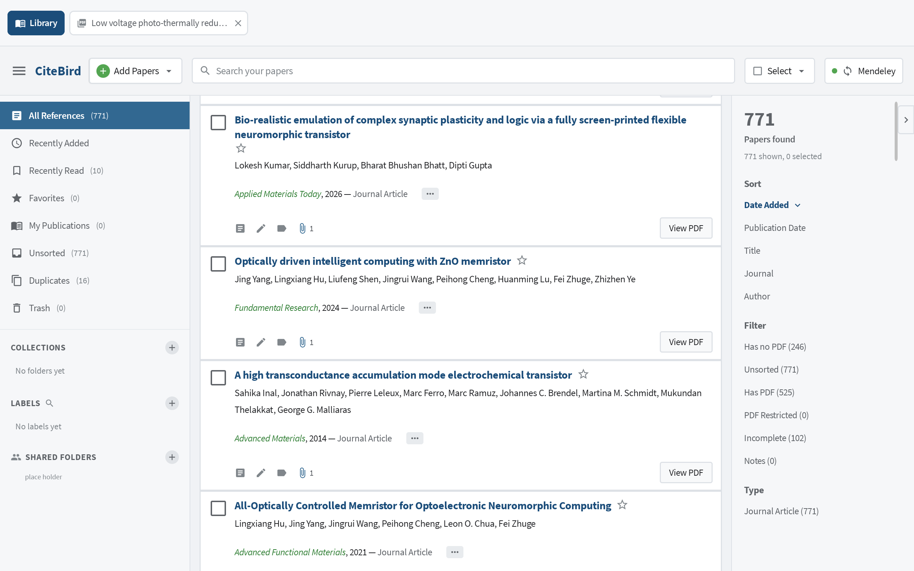

# CiteBird — Open-Source Mendeley & EndNote Alternative for Android

An open-source, tablet-first **reference manager and academic PDF annotator** built as a modern replacement for the discontinued **Mendeley for Android** app and a lightweight **EndNote for Android** / **OneNote-style PDF** alternative.

**[Download Latest APK (v1.0.0)](https://github.com/physicistlk/citebird-mendeley-android/releases/latest)**

## Screenshots

| Landscape | Portrait |
| --- | --- |
|  |  |

## Looking for Mendeley for Android or EndNote for Android?

Elsevier discontinued the official **Mendeley for Android** app, and **EndNote for Android** leaves many tablet researchers without a fast, offline-friendly PDF workspace. **CiteBird** connects directly to your existing Mendeley Web Library while keeping all PDFs, folders, tags, and annotations stored locally on your Android tablet.

## Key Features

- **Mendeley Library Sync:** Sign in with your Mendeley account and pull references, PDFs, collections/folders, labels, and starred items in the background.
- **3-Column Tablet Workspace:**
  - Collapsible left sidebar (`All References`, `Recently Added`, `Recently Read`, `Favorites`, `My Publications`, `Unsorted`, `Duplicates`, `Trash`, `Collections`, `Labels`).
  - Tap any paper title to open its PDF directly, or tap the card for quick metadata, BibTeX/DOI copy, notes, and SAF export.
  - Collapsible right sort & facet-filter panel (collapsed by default in portrait, open in landscape).
- **Multi-Tab PDF Reader & Liquid Glass Toolbar:**
  - Open multiple PDFs in top tabs, **Single Page** or **2-Page Book Spread**, **Continuous Scroll** or **Paged Swipe**, and crisp vector pinch-to-zoom.
  - Annotate with **Pen (freehand ink)**, **Text Highlighter**, **Underline**, **Sticky Notes**, and **Eraser** (long-press any annotation to delete).
- **Full-Screen Immersive Reading:** Auto-hiding system bars with zero proprietary PDF SDKs and zero telemetry.

## Build from Source

Requires Android SDK 36 and JDK 21:

```bash
./build.sh :app:assembleRelease
```

## License

MIT
